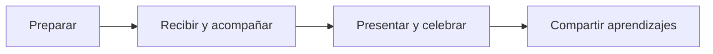

# Organización

Estas páginas reúnen criterios y listas de verificación para equipos que quieran organizar una sede. Son un punto de partida: deben adaptarse a las reglas vigentes de Global Game Jam, a la normativa local, al espacio y a las necesidades de cada comunidad.

## Una sede, muchas comunidades

Cada sede tiene su identidad y se conecta con otras personas y comunidades de su localidad y provincia, con las sedes de Argentina y con la comunidad mundial de Global Game Jam. Organizar una sede también es formar parte de ese encuentro más grande: compartir experiencias, aprender de otras sedes y construir vínculos que continúan después del evento.

La organización regional acompaña y conecta a las sedes argentinas con Global Game Jam. Mantené el contacto, consultá las indicaciones de cada edición y acercate a otras comunidades de tu zona para intercambiar ideas y colaborar.

## Principios

Las sedes y sus equipos deben conocer las [políticas y reglas de GGJ](../politicas-ggj.md), incluidos los códigos de conducta y los requisitos de la edición.

- **Aprender haciendo:** experimentar, equivocarse y volver a intentar. No hace falta ser experto ni terminar un juego perfecto.
- **Colaborar entre disciplinas:** dar lugar a distintos conocimientos, experiencias y formas de crear. La diversidad de perspectivas enriquece a los equipos.
- **Ser parte de una comunidad global:** conectar la identidad local de cada sede con las demás comunidades de Argentina y del mundo, compartiendo experiencias y acompañándonos.
- **Cuidar y acompañar:** construir un entorno respetuoso y accesible, donde las personas puedan pedir ayuda, descansar y participar según sus necesidades.
- **Celebrar la creatividad local:** las historias, sonidos, costumbres y experiencias de cada comunidad pueden inspirar nuevas ideas.
- **Comunicar con claridad:** explicar horarios, reglas, recursos disponibles y límites de la sede.
- **Respetar la privacidad:** solicitar consentimiento antes de publicar imágenes o datos de participantes.
- **Compartir lo aprendido:** conservar experiencias y conocimientos para otras personas y futuras sedes.

Recorré la [guía de fechas](cronograma.md), [antes del evento](antes-del-evento.md), [durante y después](durante-y-despues.md) y las [plantillas](plantillas.md). Adaptalas al tamaño y necesidades de tu sede. Consultá las condiciones y fechas vigentes con [Global Game Jam](https://globalgamejam.org/) y la organización regional.
